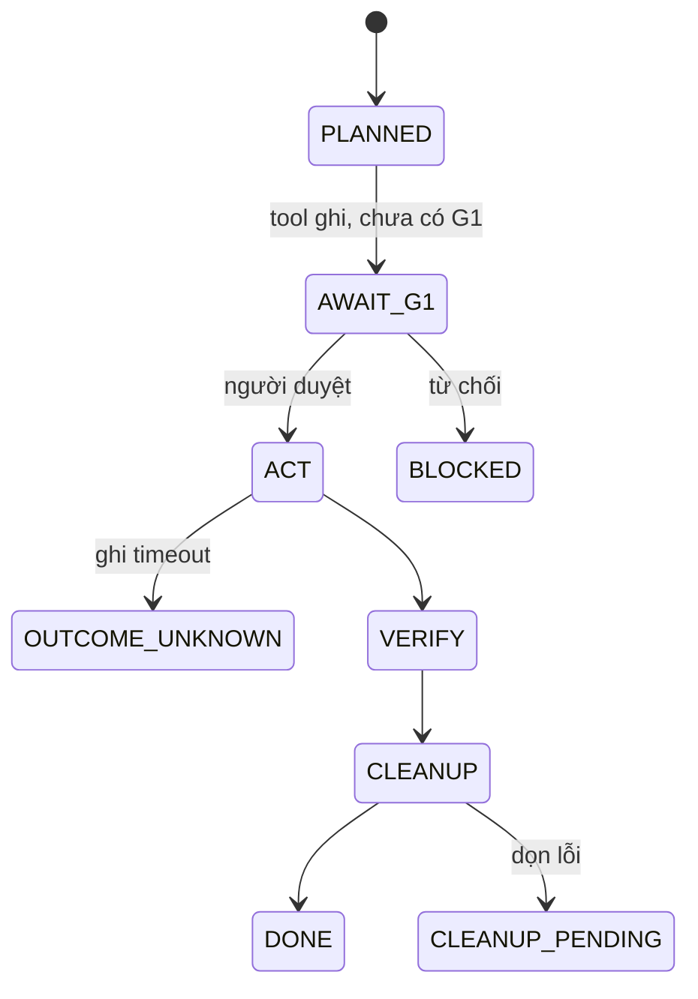

# State machine: <tên agent>

> Gốc: `ai-qe-kit/templates/state_machine.md`. Ví dụ chạy được: `agent/src/state_machine.ts`; invariant: `docs/agent_design.md` mục 4.

## Trạng thái
- Chưa kết thúc: PLANNED, AWAIT_G1, SETUP, ACT, VERIFY, CLEANUP, OUTCOME_UNKNOWN
- Kết thúc: DONE, CLEANUP_PENDING, BLOCKED, BLOCKED_NEEDS_HUMAN, CANCELLED, FAILED

## Chuyển trạng thái
| Từ | Sự kiện | Guard | Đến | Evidence ghi |
|---|---|---|---|---|
| | | | | |

## Invariant (ép bằng code hoặc policy, không chỉ bằng prompt)
| # | Invariant | Ép ở đâu (controller / adapter / server) | Vi phạm thì | Hàng threat |
|---|---|---|---|---|
| 1 | Trước WRITE: có G1 còn hiệu lực, đúng run/env/case | | | 🧯 |
| 2 | Trước PASS: verify đạt + cleanup xong (hoặc không tạo record) | | | 🧯 |
| 3 | Oracle bất biến trong run; đổi cần G3 + run mới | | | 🧯 |
| 4 | Ghi không rõ kết quả: không ghi lại, chỉ tra cứu | | | 🧯 |

## Sơ đồ

